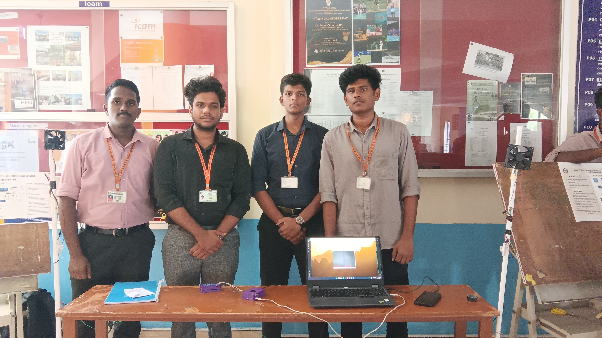

# Smart Classroom Automation System

A Raspberry Pi-based smart classroom automation prototype that uses computer vision to detect people and control fans and lights in two classroom zones.

## Project Overview

The system uses a USB webcam to capture live video and YOLOv4-tiny to detect people. The camera view is divided into two zones, and the Raspberry Pi controls the corresponding fans and lights through a relay module based on person detection.

When no person is detected in a zone, its appliances switch off after a five-second delay.

## Features

- Real-time person detection using YOLOv4-tiny and OpenCV
- Two-zone classroom monitoring
- Automatic fan and light control through a relay module
- Five-second delay before switching off appliances
- Live camera feed with detection bounding boxes and zone status

## Hardware Requirements

- Raspberry Pi 4 Model B
- USB webcam
- Four-channel relay module
- 2 × 12V DC fans
- 2 × 12V DC lights
- 12V DC power supply

## Technologies Used

- Python
- OpenCV
- NumPy
- YOLOv4-tiny
- Raspberry Pi GPIO

## Project Structure

```text
smart_classroom/
├── smart_classroom.py
├── camera_test.py
├── relay_test.py
├── models/
├── tf_model/
├── yolo/
├── images/
└── README.md
```

## Working Principle

1. The webcam captures live video of the classroom.
2. YOLOv4-tiny detects people in the video feed.
3. The camera frame is divided into two zones.
4. The Raspberry Pi activates the corresponding relay when a person is detected in a zone.
5. The connected fan and light switch off after five seconds without a person detection in that zone.

## Project Demonstration

### Team at the Project Expo



### Project Demo

[Watch the project demonstration]([Demo](https://drive.google.com/file/d/1bbCJaS_sHcuXeVkN4cuymddTlO2UcbyY/view?usp=sharing))

### Project Presentation

[Watch the project presentation at the expo]([Presentation](https://drive.google.com/file/d/1aRWDXM72NurcENM3LAKull8CcfH0-_yj/view?usp=sharing))


